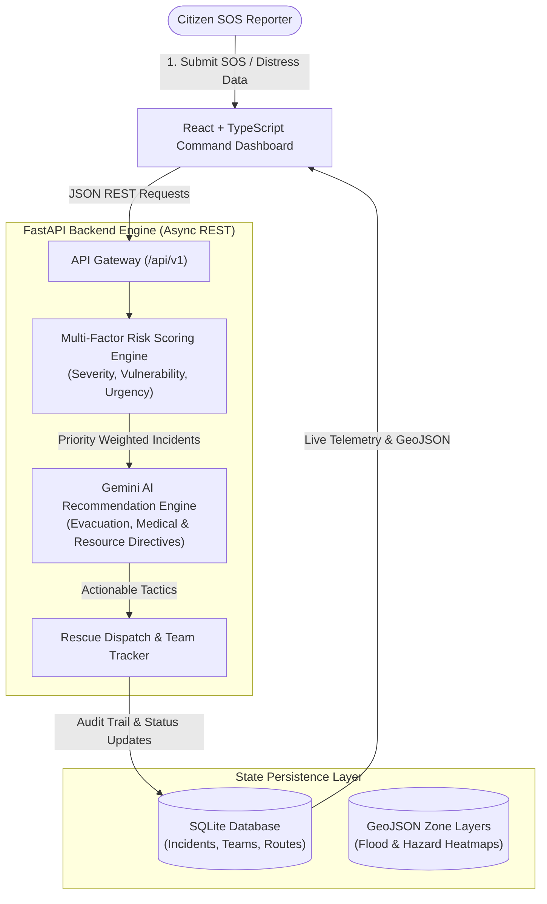
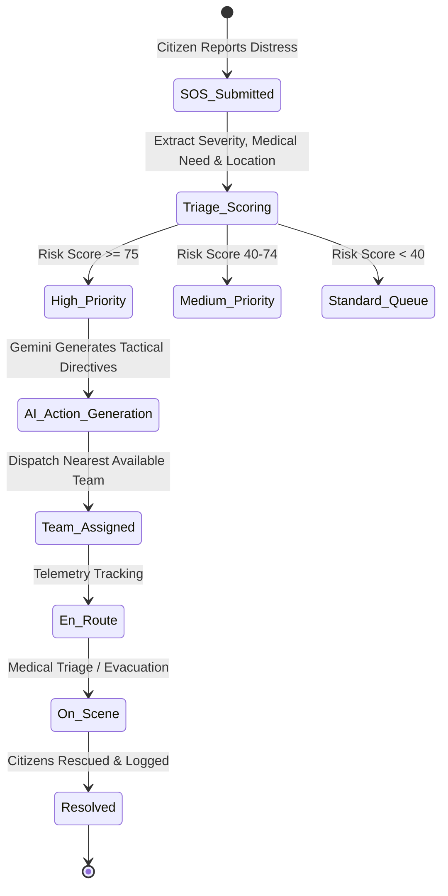

# RESQ-AI — Disaster Response Intelligence Platform

[](https://www.python.org/)
[](https://fastapi.tiangolo.com/)
[](https://react.dev/)
[](https://vitejs.dev/)
[](https://leafletjs.com/)
[](https://ai.google.dev/)
[](https://www.sqlite.org/)

An AI-assisted disaster response intelligence and emergency rescue coordination command center. RESQ-AI integrates multi-channel citizen SOS intake, automated risk triage, geospatial hazard mapping, AI-generated evacuation recommendations (via Google Gemini), and dynamic rescue team dispatch into a cohesive operational dashboard.

---

## 🏛️ System Architecture



---

## 🚨 Incident Triage & Operational Lifecycle



---

## ✨ Core Capabilities

| Module | Technical Implementation | Operational Role |
| :--- | :--- | :--- |
| **Command Center HUD** | React 18, Tailwind CSS, Lucide Icons | Real-time overview of active SOS signals, casualties prevented, available teams, and bottleneck alerts. |
| **Geospatial Intelligence** | Leaflet, OpenStreetMap, GeoJSON | Interactive zone-level inundation maps, high-risk sector overlays, and safe evacuation corridors. |
| **Citizen SOS Intake** | Async FastAPI Form Validator | Mobile-friendly emergency reporting capturing distress category, medical vulnerabilities, and GPS coordinates. |
| **AI Decision Support** | Google Gemini API integration | Converts unstructured incident telemetry into prioritized supply, medical triage, and helicopter dispatch recommendations. |
| **Resource Management** | SQLite, SQLAlchemy ORM | Live operational status tracking for NDRF teams, volunteer squads, inflatable boats, and medical shelters. |

---

## 🚀 Quickstart: Local Setup

### Prerequisites
* **Python**: 3.10+
* **Node.js**: 18+ and `npm`

### 1. Backend Setup

```bash
cd backend

# Create and activate virtual environment
python -m venv .venv
# Windows: .venv\Scripts\Activate.ps1 | Linux/macOS: source .venv/bin/activate

# Install dependencies
pip install -r requirements.txt

# Populate demo scenario (Bhopal urban flood simulation)
python seed.py

# Launch FastAPI server
python main.py
```
*Backend API will listen at `http://127.0.0.1:8000` with interactive Swagger docs at `/docs`.*

### 2. Frontend Setup

In a separate terminal:

```bash
cd frontend

# Install packages
npm install

# Start Vite development server
npm run dev
```
*Open `http://localhost:5173` in your browser to access the RESQ-AI Command Center.*

---

## 📂 Repository Structure

```text
resq-ai/
├── backend/
│   ├── app/
│   │   ├── routers/           # Incident, team, SOS, and AI recommendation endpoints
│   │   ├── models/            # SQLAlchemy database schemas
│   │   ├── schemas/           # Pydantic request & response validators
│   │   └── services/          # Gemini AI integration & triage scoring
│   ├── main.py                # FastAPI application entrypoint
│   ├── seed.py                # Seed script for realistic demo incident records
│   └── requirements.txt
├── frontend/
│   ├── src/
│   │   ├── components/        # MapView, SOSModal, StatsCards, TeamManager
│   │   ├── services/          # Axios API communication layer
│   │   └── App.tsx            # Central dashboard composition
│   ├── vite.config.ts
│   └── package.json
└── README.md
```

---

## 📜 Ethical & Simulation Notice
* Developed as an academic and hackathon demonstration for AI-assisted emergency response.
* All incident data, citizen identities, and coordinates are deterministic synthetic simulations.
